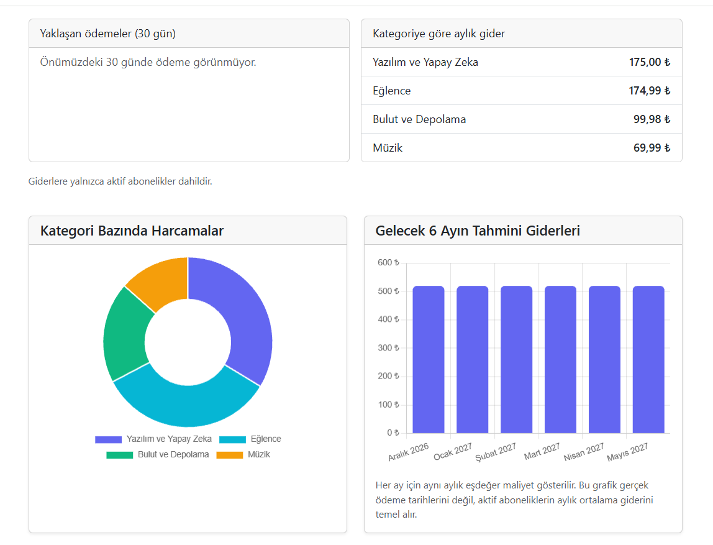
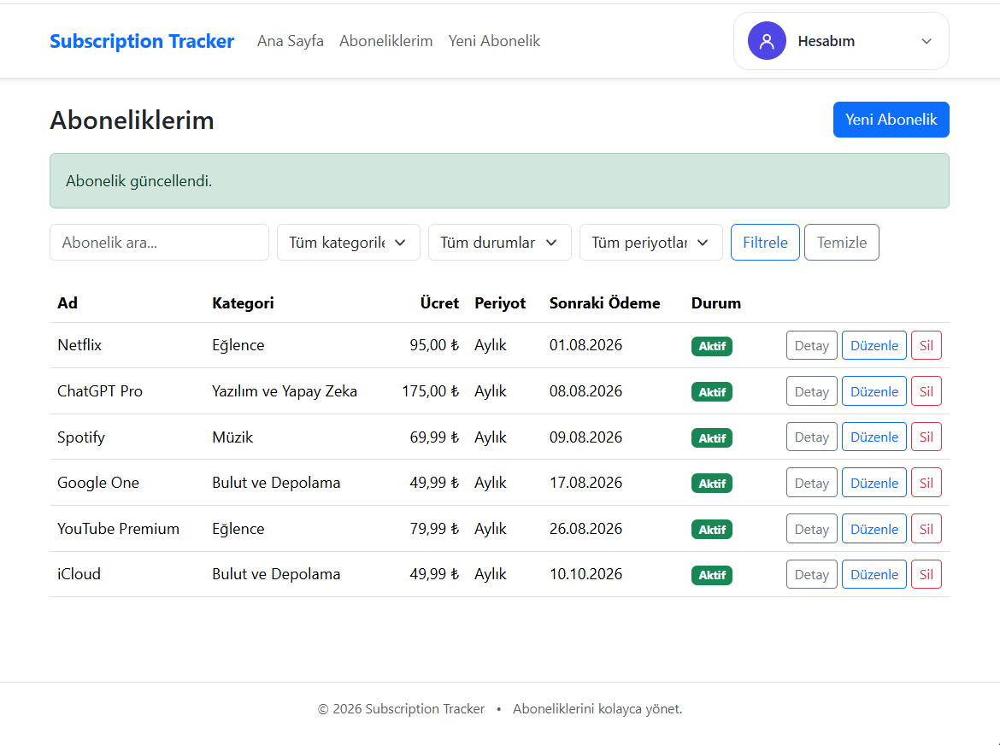
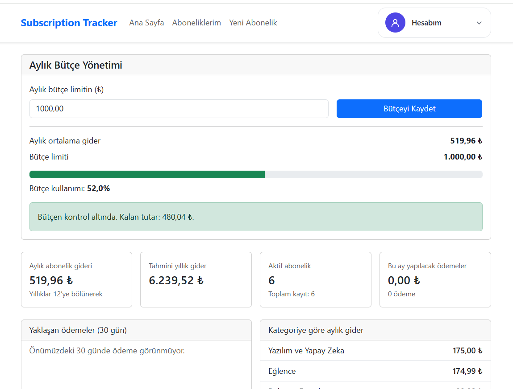
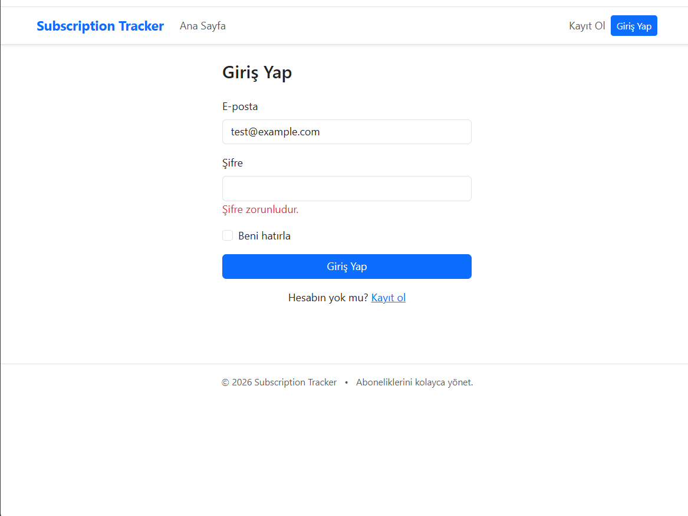
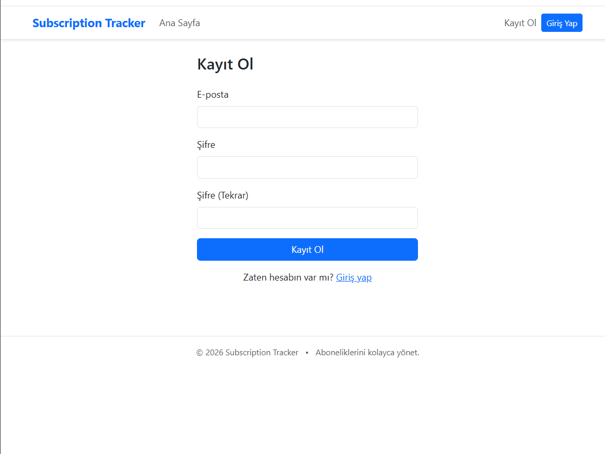

# 💳 Subscription Tracker

Düzenli ödemelerinizi (Netflix, Spotify, faturalar, spor salonu üyeliği vb.) tek bir yerden takip etmenizi, aylık bütçenizi yönetmenizi ve harcamalarınızı grafiklerle görmenizi sağlayan, **ASP.NET Core MVC** ile geliştirilmiş bir web uygulaması.



## ✨ Özellikler

- **Kullanıcı Hesapları:** ASP.NET Core Identity ile güvenli kayıt, giriş ve çıkış. Her kullanıcı yalnızca kendi verilerini görür.
- **Abonelik Yönetimi:** Abonelik ekleme, görüntüleme, düzenleme ve silme (ad, kategori, ücret, aylık/yıllık periyot, ödeme tarihi, aktif/pasif durumu, not).
- **Filtreleme ve Arama:** Abonelikleri ada, kategoriye ve duruma göre filtreleme.
- **Dashboard:** Aylık ve yıllık toplam gider, aktif abonelik sayısı ve yaklaşan ödemeler. Yıllık abonelikler aylık maliyete çevrilerek hesaplanır.
- **Bütçe Yönetimi:** Aylık harcama limiti belirleme; limitin %90'ına yaklaşıldığında ve aşıldığında uyarı.
- **Grafikler:** Kategori bazlı harcama dağılımı ve önümüzdeki 6 ayın tahmini harcamaları (Chart.js).
- **Hesap Ayarları:** Hesap bilgilerini görüntüleme ve şifre değiştirme.
- **Hata Yönetimi:** Geçersiz sayfalar ve beklenmeyen hatalar için özel hata sayfaları.
- **Responsive Tasarım:** Bootstrap ile mobil uyumlu arayüz.

## 📸 Ekran Görüntüleri

<table>
  <tr>
    <th width="50%">Abonelikler</th>
    <th width="50%">Bütçe Yönetimi</th>
  </tr>
  <tr>
    <td></td>
    <td></td>
  </tr>
  <tr>
    <th>Giriş</th>
    <th>Kayıt</th>
  </tr>
  <tr>
    <td></td>
    <td></td>
  </tr>
</table>


## 🛠️ Kullanılan Teknolojiler

| Teknoloji | Kullanım Amacı |
|---|---|
| C# / .NET 10 | Backend geliştirme |
| ASP.NET Core MVC | Uygulama mimarisi |
| Entity Framework Core | Veritabanı işlemleri (Code First, Migration) |
| SQL Server | Veri depolama |
| ASP.NET Core Identity | Kimlik doğrulama ve hesap yönetimi |
| Razor Views | Sunucu taraflı arayüz |
| Bootstrap | Responsive tasarım |
| Chart.js | Veri görselleştirme |
| Git & GitHub | Versiyon kontrolü |

## 🚀 Kurulum

### Gereksinimler

- [.NET 10 SDK](https://dotnet.microsoft.com/download)
- SQL Server, SQL Server Express veya LocalDB
- Git

### Adımlar

1. Repoyu klonlayın:

   ```bash
   git clone https://github.com/Fahriyeelifdikci/SubscriptionTracker.git
   cd SubscriptionTracker/src/SubscriptionTracker.Web
   ```

2. Veritabanı bağlantı cümlesini **User Secrets** ile ayarlayın (gizli bilgiler repoya eklenmez):

   ```bash
   dotnet user-secrets set "ConnectionStrings:DefaultConnection" "Server=(localdb)\\MSSQLLocalDB;Database=SubscriptionTrackerDb;Trusted_Connection=True;TrustServerCertificate=True"
   ```

3. EF Core aracını yükleyin (yüklü değilse) ve migration'ları uygulayın:

   ```bash
   dotnet tool install --global dotnet-ef
   dotnet ef database update
   ```

4. Uygulamayı çalıştırın:

   ```bash
   dotnet run
   ```

5. Terminalde görünen yerel adresi tarayıcıda açın.

## 📁 Proje Yapısı

```
SubscriptionTracker/
├── src/
│   └── SubscriptionTracker.Web/
│       ├── Controllers/     # İstekleri karşılayan controller'lar
│       ├── Data/            # DbContext ve veritabanı yapılandırması
│       ├── Extensions/      # Yardımcı extension metotları
│       ├── Migrations/      # EF Core migration dosyaları
│       ├── Models/          # Entity sınıfları
│       ├── Services/        # İş mantığı (ör. maliyet hesaplama)
│       ├── ViewModels/      # View'lara özel modeller ve validation
│       ├── Views/           # Razor view'ları
│       ├── wwwroot/         # CSS, JS ve statik dosyalar
│       └── Program.cs       # Uygulama başlangıç ve servis kayıtları
├── docs/screenshots/        # README ekran görüntüleri
├── .gitignore
├── README.md
└── SubscriptionTracker.slnx
```

## 🔮 Gelecek Planları

- Yaklaşan ödemeler için e-posta hatırlatmaları
- Çoklu para birimi desteği
- Harcama raporlarını dışa aktarma (PDF/Excel)
- Daha detaylı harcama analizleri

## 🎯 Projenin Amacı

Bu proje; ASP.NET Core MVC, veritabanı tasarımı, kullanıcı kimlik doğrulama ve full-stack web geliştirme konularında pratik deneyim kazanmak amacıyla geliştirilmiştir.

## 👩‍💻 Geliştirici

**Fahriye Elif Dikci**
[GitHub](https://github.com/Fahriyeelifdikci)
